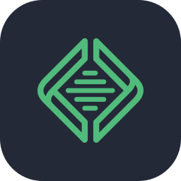

<!-- ───────────────────────── HEADER ───────────────────────── -->

   header" />

  

  
  
  

 

## `01` — About

I'm Christian. I design interfaces, build websites and solve visual problems.
I like structure, details and the moment when code and design click together.

I work **analytically**, so I figure out what users need before I open Figma or VS Code.
Then I turn that into designs that look intentional and code that holds up.

  <code>Analytical</code> ·
  <code>Structured</code> ·
  <code>Problem Solver</code> ·
  <code>User-focused</code> ·
  <code>Detail-oriented</code> ·
  <code>Reliable</code> ·
  <code>Creative</code>

 

## `02` — What I do

<table>
  <tr>
    <td width="33%" valign="top">
      <code>01</code> 
      <b>&lt;Frontend Developer/&gt; ↗</b>  
      Semantic HTML, modern CSS (Grid, Flexbox, custom properties) and vanilla JavaScript.
      Responsive, accessible, and shipped through GitHub.
    </td>
    <td width="33%" valign="top">
      <code>02</code> 
      <b>UX/UI Designer ↗</b>  
      User research, information architecture, wireframes and hi-fi prototypes in Figma,
      validated with think-aloud and 5-second tests.
    </td>
    <td width="33%" valign="top">
      <code>03</code> 
      <b>Graphic Designer ↗</b>  
      Visual identities, layouts and typography in Photoshop, Illustrator and InDesign,
      built on a solid grid.
    </td>
  </tr>
</table>

 

## `03` — Tools & Stack

  
   
  
   
  Also: FigJam

 

## `04` — Selected work

| | Project | Stack | About |
|:-:|---|---|---|
| 🗂️ | **[Portfolio](https://github.com/ckbreuning/portfolio)** · [live](https://www.ckbreuning.com) | PHP · CSS · JS · WordPress | My portfolio as a custom WordPress theme. Cases are a custom post type with ACF fields and filtering, and every push to `main` deploys to ckbreuning.com through GitHub Actions |
| 🏆 | **[SGL](https://github.com/ckbreuning/sgl)** · [live](https://sgl.ckbreuning.com) | Vue · Vite | Results site for Supernova Gaming League, the Counter-Strike tournament organiser I co-founded in 2022. Standings, the bracket and the champion are worked out from the match data |
| 🌿 | **[Lene Stegenborg](https://github.com/ckbreuning/lene-stegenborg)** | HTML · CSS · JS | Redesign for a coach and therapist. Her treatments are loaded from a headless WordPress via the REST API, and the FAQ is an accessible accordion |
| 🥋 | **[Hjørring Jiu-Jitsu Klub](https://github.com/ckbreuning/hjoerring-jiu-jitsu-klub)** | HTML · CSS | Group redesign of the club's 14-page website, from sitemap and wireframes to think-aloud tests and the final HTML/CSS build |
| 🐘 | **[Valgfag](https://github.com/ckbreuning/valgfag)** | PHP · WordPress | <!-- TODO: one line about the project --> |

 

## `05` — GitHub stats

  
  

  

  <picture>
    <source media="(prefers-color-scheme: dark)" srcset="https://raw.githubusercontent.com/ckbreuning/ckbreuning/output/snake-dark.svg" />
    <source media="(prefers-color-scheme: light)" srcset="https://raw.githubusercontent.com/ckbreuning/ckbreuning/output/snake-light.svg" />
    
  </picture>

 

## `06` — Let's work together

I'm open to **internships, freelance projects and collaborations**. I'd especially like to work with creative agencies and esports and tech teams.

  
  
  

  

